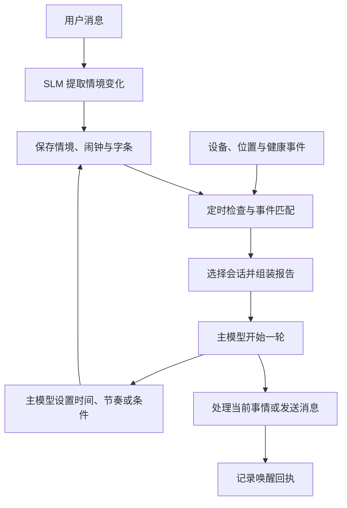

# wake_UP

wake_UP 实现主动唤醒：从对话中记录正在持续的情境，按时间或事件重新唤起模型，并把相关状态和短期字条交给它。Python 包名为 `deamo-wake`，导入名称为 `deamo_wake`。

例如，模型可以在你出门期间每隔一段时间醒来一次，等你离开办公室时再联系，或为下一次对话设定明确的唤醒时间。每次醒来，它都可以根据当时的情况调整后续安排。

## 功能

### 从对话建立、更新和结束情境

接入 SLM（负责分类的小模型）后，每条真实用户消息都会与当前有效情境一起交给它，生成情境变化：

| 对话中的信息 | 对应处理 |
|---|---|
| “我出门一会儿。” | 建立外出情境，保存事实与后续唤醒时间。 |
| “接下来要忙工作了。” | 建立工作情境，按该情境的节奏运行。 |
| “晚安，我去睡了。” | 建立睡前情境，后续结合设备状态判断是否进入睡眠。 |
| “每隔十分钟来找我一次。” | 建立重复情境，保存十分钟的间隔。 |
| “回来了。”、“今天做完了。” | 根据消息含义结束对应的外出或工作情境。 |

这里的“情境”（scene）是一段有持续时间的状态，包含已知事实、开始时间、有效期、下次唤醒时间和检查间隔。一条消息可以同时结束旧情境、开始新情境。分类依据当前已经发生的事情；未来某个时间要做的事，可以通过闹钟记录。

目前有十种情境，以下是基础默认值。具体事件入口、用户明确提出的安排和模型工具调用可以调整它们。

| 情境 | 用途 | 默认间隔 | 默认有效期 |
|---|---|---:|---:|
| `outing` | 外出 | 30 分钟 | 8 小时 |
| `work` | 工作或学习 | 60 分钟 | 10 小时 |
| `bedtime` | 准备睡觉 | 45 分钟 | 10 小时 |
| `morning` | 早晨设备恢复活动 | 20 分钟 | 3 小时 |
| `active_without_chat` | 设备活跃、尚未回到聊天 | 30 分钟 | 4 小时 |
| `silence_escalation` | 明确约定未回复时继续跟进 | 15 分钟 | 4 小时 |
| `repeat` | 按约定间隔重复唤醒 | 10 分钟 | 3 小时 |
| `private_play` | 由指定 App 事件开启的情境 | 10 分钟 | 1 小时 |
| `sulking` | 争执或生气期间的持续情境 | 20 分钟 | 8 小时 |
| `custom` | 自定义情境 | 45 分钟 | 6 小时 |

多个情境可以同时存在，各自保存间隔和有效期。同一轮到期的情境会合并到一份唤醒报告里，由同一次模型回合处理。

### 让主模型安排下一次唤醒

主模型在正常聊天和唤醒回合中都可以调用调度工具，决定接下来怎么继续：

| 想做的安排 | 工具动作 |
|---|---|
| “二十分钟后再回来看看，后面也保持这个间隔。” | `collar_companion` 的 `update_scene`，设置 `cadence_min`。 |
| “今晚九点叫醒我处理这件事。” | `set_alarm`，设置具体时间和届时要读的备注。 |
| “接下来两小时，每十分钟来一次。” | `set_repeat`，同时设置间隔和有效期。 |
| “等某件事发生时叫我。” | `start_scene` 或 `update_scene`，设置 `wake_when`。 |
| “这段情境已经结束了。” | `end_scene`。也可指定同类设备情境暂缓重新建立的时间。 |
| “接下来一小时先休息。” | `snooze`，暂停巡检和普通设备情境。 |

情境间隔可设为 5–240 分钟，有效期可设为 10–1,440 分钟。持续情境会按已保存的节奏再次到期。模型主动设定的节奏会保留，用户在新消息中明确提出的安排也可以更新它。

### 等待一个事件发生

`wake_when` 让主模型用一句自然语言设置唤醒条件。设置时，SLM 将这句话翻译成一条结构化规则，工具会返回它理解的含义；之后由代码持续匹配事件。

| 可以等待的事情 | 条件示例 | 需要接入的数据 |
|---|---|---|
| 到达一个地点 | “到家时叫我。” | 用户授权的位置或围栏到达事件，以及已配置的地点名称。 |
| 离开一个地点 | “离开办公室时叫我。” | 用户授权的位置或围栏离开事件。 |
| 打开一个 App | “打开指定 App 时叫我。” | 手机或平板的 App 打开事件，以及已配置的 App 名称。 |
| 连续使用 App 达到时长 | “连续使用这个 App 二十分钟时叫我。” | 当前 App、开始使用时间和后续状态。 |
| 安静后恢复设备活动 | “设备安静半小时后重新开始使用时叫我。” | 手机、平板或电脑的活动记录。 |
| 设备持续安静 | “所有设备安静半小时后叫我。” | 手机/平板的使用状态，以及 Mac 的在线、锁屏或闲置状态。 |

时长条件支持 5–720 分钟，也可以限定一个时间段，例如“只在晚上生效”。每个情境保存一条条件，并可同时保留定时间隔：时间到或条件命中，都能发起唤醒。普通定时唤醒会保留尚未命中的条件；条件命中且该轮成功完成后，条件会自动清除。

以“离开办公室时联系”为例，完整过程是：

1. 接入用户授权的位置数据，将办公室配置为一个已知地点。
2. 主模型为当前情境设置“离开办公室时叫我”。
3. 位置采集程序检测到离开围栏，向 wake_UP 提交 `leave` 事件。
4. 规则命中，唤醒报告写明发生了什么、此前的情境和约定。
5. 主模型开始这一轮处理；决定联系时，通过 `notify_user` 发送消息。

位置、App 和设备状态都通过事件接口接入。这些数据源可按需要逐项配置，聊天情境和闹钟也各有自己的入口。

### 同时处理几条唤醒路线

| 路线 | 什么时候触发 |
|---|---|
| 闹钟 | 主模型设定的具体时间到达。 |
| 情境 | 某个情境的下次时间到达，或它的事件条件命中。 |
| 巡检 | 默认每 15 分钟检查一次，通过时间、近期对话和状态门槛后，由 SLM 判断是否值得唤醒。 |
| 健康阈值事件 | 接入用户授权的健康样本后，连续的新鲜样本满足配置的阈值规则。 |

普通检查按“闹钟 → 情境 → 巡检”的顺序处理。已有持续情境时，由情境自己的节奏安排后续唤醒。健康阈值事件有独立入口，并使用连续样本确认、冷却时间和每日额度。

设备静默、最近聊天和睡前情境会参与调度判断。睡前情境可以记录一次入睡确认；普通情境的定时检查在睡眠期间顺延。用户重新发言或设备活动达到相应规则后，睡眠情境会结束。

### 给后续唤醒留下短期字条

主模型可以给一个正在运行的情境留字条，例如“下一次回来时，记得问刚才提到的那件事”。创建或更新情境时可填写 `nudge`；也可以用 `collar_companion` 的 `set_note` 和 `clear_note`，通过 `scene_id` 指定要写入或清除字条的情境。

字条在相关报告中被展示，且该轮成功完成并有实质内容时，才消费一次。默认可读三次；替换成新字条后，旧回合会核对字条版本，避免把新字条的次数扣掉。情境、字条、闹钟和回执保存在 SQLite 中，重启后继续读取。

### 醒来时带上当时需要的信息

每次唤醒会整理一份报告，包含触发原因、当前有效情境、已知设备状态、相关短期字条。按模型会话已接收的唤醒次数，第 1、6、11……次使用完整报告，中间使用精简报告。

情境唤醒会跟随用户最近实际发过消息、且允许唤醒的聊天。报告连同会话标识交给模型运行函数，由现有聊天程序装载这段对话的历史、设定和记忆。用户发来新消息时，运行中的唤醒回合会收到中断信号；接入时将它连接到现有模型运行器的中断处理。

模型在这一轮里可以查看当前情境、更新下一次安排，或主动联系用户。`notify_user` 负责显式发送消息。系统分别记录“模型已接收”“该轮已完成”“通知已送达”，便于处理重试和连接中断。

## 怎样实现



SLM 承担三项任务：从真实消息提取情境增量、把 `wake_when` 翻译为规则、为巡检给出是否唤醒的判断。时间比较、事件匹配、优先级、领取与回执结算由代码执行。

## 接到自己的聊天程序

项目中的 `WakeEngine` 连接以下几个入口。已有的聊天、数据库和记忆读取逻辑可以放在对应回调中继续使用。

| 接入位置 | 要连接的内容 |
|---|---|
| 用户消息入口 | 调用 `user_message(...)`，传入真实消息 ID、会话 ID、文本和时间。 |
| 助手回复完成 | 调用 `assistant_activity(...)`，更新最近回复时间。 |
| 小模型调用 | 提供 `slm` 回调，调用选定的模型并返回解析后的 JSON 对象。 |
| 主模型调用 | 提供 `runner` 回调，按会话 ID 读取对话和记忆，将唤醒报告加入上下文，执行模型与工具回合。 |
| 发送消息 | 提供 `notifier` 回调，把明确发送的消息写入对应聊天或通知通道，并返回送达结果。 |
| 数据事件入口 | 用 `observe(...)` 提交已接入的数据源产生的标准化事件。 |
| 后台调度 | 周期调用 `tick()`，或运行 `run()`。 |

可以先接好用户消息、主模型调用和闹钟，再增加自动情境识别、位置或设备条件。`SQLiteStore` 保存本项目的唤醒状态；现有聊天记录和长期记忆按原来的数据访问方式，由 `runner` 读取并加入模型上下文。

完整回调签名、工具参数、会话映射、事件 JSON 和初始化步骤见[接入指南](docs/integration.md)。调度顺序、状态结构和默认值见[架构说明](docs/architecture.md)。

## 安装与示例

要求 Python 3.11 或以上。以下使用 Python 3.12：

```sh
python3.12 -m venv .venv
. .venv/bin/activate
python -m pip install -e .
python examples/local_wake.py
python examples/scene_condition.py
python -m unittest discover -s tests -v
```

- `local_wake.py`：设置闹钟，运行模型回调，发送一条消息，再读取保存的回执。
- `scene_condition.py`：从用户消息建立情境，设置 App 事件条件，提交事件并完成唤醒；模型在回合中调整后续节奏。

示例使用临时 SQLite 和本地回调，可直接运行查看整个过程。接入自己的聊天程序时，将回调连接到实际的模型和消息通道。

## 运行设置

初始化后，通过 `await engine.configure(enabled=True, wake_live=True)` 开启调度执行。一个数据库对应一个 `WakeEngine` / `SQLiteStore` 实例。时间戳按 UTC 保存；活动时段、自然日计数和条件时间窗口当前固定使用 UTC+08:00。

## 许可证

本项目采用 [PolyForm Noncommercial License 1.0.0](LICENSE)，允许按许可条款进行非商业使用、修改和分享。

## 共同开发

[KKarsyline](https://github.com/KKarsyline)、Codex、Claude Code。
